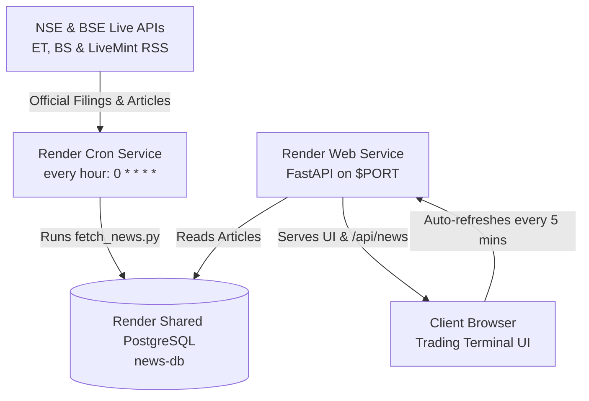

# 📈 Dalal Street Pulse - Automated Indian Stock Market News Wire

A fully autonomous, 24/7 financial and stock market news aggregator tailored for Indian equity, F&O, Nifty, and Sensex traders.

The system continuously fetches, parses, deduplicates, categorizes, and streams real-time headlines and corporate filings from:
- 🔴 **NSE India (National Stock Exchange)**: Real-time corporate announcements & official PDF filings
- 🟣 **BSE India (Bombay Stock Exchange)**: Regulation 30 disclosures, board meetings, and results
- 🟠 **Economic Times Markets & ET Stocks**: Leading market commentary and financial wire
- 🔵 **Business Standard**: Top business and macroeconomic stories
- 🟢 **LiveMint**: Live stock analysis and market updates

---

## ⚡ Architecture & Deployment Overview

The project is structured for zero-maintenance deployment on **Render**:



1. **Web Service (`app.py`)**:
   - Built with **FastAPI** + **Uvicorn**, binding to `process.env.PORT`.
   - Exposes `GET /api/news`, `GET /api/stats`, `POST /api/refresh`, and `GET /api/health`.
   - Serves the mobile-first, dark-themed trading terminal frontend.
   - On startup, if the database is empty, performs an initial background ingest so news displays instantly.

2. **Cron Job Service (`fetch_news.py`)**:
   - Executes autonomously every hour (`0 * * * *`).
   - Fetches all 4 RSS feeds, removes duplicate articles by URL, formats IST dates, assigns sentiment/signal tags (🟢 Bullish, 🔴 Bearish, 📊 Earnings, 🏛️ Policy), and writes to the shared database.
   - Runs once and exits with code `0`.

3. **Persistent Database (`database.py`)**:
   - In production (Render): Connects via `DATABASE_URL` to a shared PostgreSQL instance.
   - In local development: Automatically falls back to a local SQLite database (`data/news.db`) with zero setup needed.

---

## 🚀 Quick Local Development

### 1. Prerequisites
- Python 3.9+ installed

### 2. Setup & Installation
```bash
# Clone or open the repository directory
cd automate_finance_news_site

# Install dependencies
pip install -r requirements.txt
```

### 3. Fetch Initial News
```bash
python fetch_news.py
```

### 4. Start the Web Server
```bash
python app.py
```
Open [http://localhost:8000](http://localhost:8000) in your browser.

---

## 🌐 Deploying to Render via Blueprint (render.yaml)

### Step 1: Push Repo to GitHub
```bash
git init
git add .
git commit -m "Initial commit - Automated Indian Stock Market News Hub"
git branch -M main
git remote add origin https://github.com/<YOUR_USERNAME>/<YOUR_REPO_NAME>.git
git push -u origin main
```

### Step 2: Deploy on Render
1. Log in to your [Render Dashboard](https://dashboard.render.com/).
2. Click **New +** in the top right corner and select **Blueprint**.
3. Connect your GitHub repository.
4. Render will automatically detect `render.yaml` and configure:
   - `news-db`: Free managed PostgreSQL database
   - `dalal-street-pulse-web`: Web Service running `uvicorn app:app --host 0.0.0.0 --port $PORT`
   - `dalal-street-pulse-fetcher`: Cron Service running `python fetch_news.py` every hour
5. Click **Apply**. Render will automatically provision all three components and link their `DATABASE_URL` credentials.

### Step 3: Adding Custom Environment Variables (e.g., API Keys)
If you add additional features (such as AI summarization with the Gemini API):
- Navigate to your Web Service / Cron Job in the Render dashboard.
- Go to **Environment** > **Add Environment Variable**.
- Add `GEMINI_API_KEY` (or any other sensitive key) here.
- **Never commit secrets or API keys into source code or Git history.**

---

## 📡 API Reference

### `GET /api/news`
Returns articles sorted newest first with optional query parameters:
- `source`: Filter by publisher (`All`, `Economic Times`, `Business Standard`, `LiveMint`).
- `sentiment`: Filter by signal (`BULLISH`, `BEARISH`, `EARNINGS`, `POLICY`, `All`).
- `search`: Keyword search in title & description.
- `limit`: Number of results (default `60`, max `200`).
- `offset`: Pagination offset.

### `GET /api/stats`
Returns total article counts, source breakdown, signal counts, and latest update timestamps.

### `POST /api/refresh`
Triggers an immediate background fetch cycle.

### `GET /api/health`
Returns health check status for uptime monitoring.

---

## 🎨 Design Features
- **Institutional Dark Aesthetic**: Deep background with trading accents (Electric Green for gains, Crimson Red for drops).
- **Live IST Market Indicator**: Dynamically calculates whether NSE/BSE is `OPEN` (09:15 - 15:30 IST), in `PRE-OPEN` (09:00 - 09:15 IST), or `CLOSED`.
- **Auto-Sync Engine**: Client polls `/api/news` every 5 minutes in the background with a countdown timer, with no page reload required.
- **Instant Filters & Search**: Search headlines by stock ticker, company, or policy keyword with instant debounced filtering.
